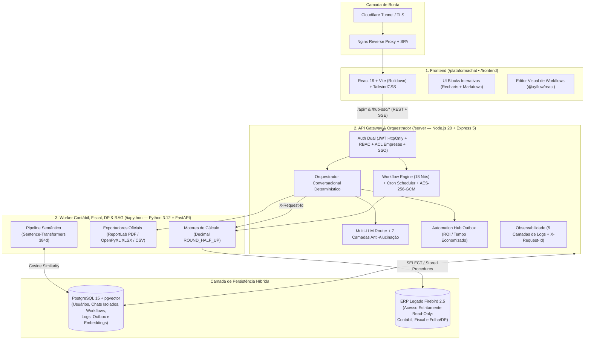

# 📊 Controller Intelligence (ChatContabil) — IA Aplicada à Contabilidade, Fiscal, DP e Automação

> **⚠️ Aviso de Showcase Arquitetural:** Este repositório é uma vitrine pública de engenharia e arquitetura de software. Devido à sensibilidade dos dados contábeis, fiscais e trabalhistas (LGPD) e à propriedade intelectual envolvida, o código-fonte de produção é mantido em repositório privado. Abaixo está documentada em detalhes a arquitetura real da plataforma em sua versão atual (**v2.0**).

---

## 💡 Sobre o Projeto

Nascido inicialmente como **ChatContabil** (voltado às demonstrações contábeis clássicas), o sistema evoluiu para o **Controller Intelligence**: uma plataforma corporativa completa de **inteligência conversacional determinística** e **orquestração de workflows (RPA/ETL)** que integra **Contabilidade, Escrita Fiscal e Departamento Pessoal (DP)** diretamente sobre bancos de dados de ERPs legados (**Firebird 2.5**) e modernos (**PostgreSQL 15 + `pgvector`**).

Em vez de depender de abordagens frágeis de *Text-to-SQL* onde a LLM tenta adivinhar queries ou somar valores financeiros por conta própria, o **Controller Intelligence** separa rigorosamente:
1. **Compreensão de Linguagem Natural e Apresentação Analítica** (Orquestrador Multi-LLM + RAG Semântico);
2. **Autoridade de Parâmetros, ACL e Cálculo Financeiro Exato** (Motor determinístico em Python com aritmética `Decimal` `ROUND_HALF_UP`, SQLs homologados e procedures nativas do ERP em modo estritamente *read-only*).

---

## 🚀 Diferenciais de Engenharia

- **Cobertura Multidisciplinar (9 Módulos — Contábil, Fiscal e DP):** Geração, auditoria e interpretação conversacional de **Balancete, DRE/DFC, Balanço Patrimonial, Razão Contábil, Faturamento/Declaração, Livro Fiscal, Apuração de ICMS/IPI, Demonstrativo de Impostos Federais (RBT12) e Departamento Pessoal (Folha, Férias, Atestados, Admissões/Demissões e Verbas)**, além de diagnóstico dedicado de **Saldos Invertidos**.
- **Orquestrador Conversacional Determinístico:** Resolução inteligente de empresas (código, razão social, fantasia sem acentos ou contexto histórico), memória *cross-intent* entre turnos (*"gere agora a DRE e a folha dela no mesmo período"*), validação de parâmetros bloqueantes sem defaults silenciosos perigosos e contexto durável de re-exportação (`PDF` ⇄ `XLSX` ⇄ `com/sem assinaturas`).
- **7 Camadas de Defesa Anti-Alucinação (`ANALYSIS_IMMUTABLE_CONTRACT`):** Antes de entregar qualquer análise ao usuário via streaming SSE, o gateway audita matematicamente cada cifra monetária citada pela LLM contra os dados estruturados do motor Python, repara formatações quebradas e bloqueia divergências numéricas.
- **Visualizações Interativas Nativas no Chat (`UI Blocks`):** A IA pode responder com gráficos validados por schema (`Recharts`: barras, linhas, pizza, cards de KPI e tabelas contábeis hierárquicas) renderizados inline na conversa.
- **Orquestração Híbrida Multi-LLM + RAG (`pgvector`):** Suporte intercambiável em tempo real para **Ollama (execução 100% local/privada)**, **OpenAI**, **Google Gemini**, **DeepSeek** e **Grok (xAI)**, combinado a embeddings vetoriais de 384 dimensões (`sentence-transformers/all-MiniLM-L6-v2`).
- **Identidade Dual, SSO e Governança RBAC:** Convivência isolada entre usuários locais (`superadmin`, `admin`, `user` com ACL por empresa) e usuários nativos do ERP legado (via autenticação direta read-only no Firebird ou **SSO Inbound** integrado ao **Automation HUB**), com segregação física de tabelas de chat e auditoria.
- **Workflow Engine Visual (18 Nós) & Cofre AES-256-GCM:** Editor em grafo (`@xyflow/react`) para automação ponta a ponta envolvendo bancos de dados, geração de relatórios, agentes de IA, leitura de planilhas, desvios condicionais, loops paralelos, sub-workflows, Google Drive, SMTP e notificações corporativas.
- **Métricas Reais de ROI / Tempo Economizado:** Integração *Transactional Outbox* com retry resiliente (`FOR UPDATE SKIP LOCKED`) que contabiliza automaticamente os minutos/segundos economizados a cada emissão de relatório via Chat Web ou Sistema Desktop.

---

## 🏗️ Arquitetura de Microsserviços

O ecossistema opera em containers Docker isolados, expostos externamente apenas por túnel criptografado apontando para o proxy reverso do Frontend, mantendo o Gateway Node.js, o Worker Python e os bancos de dados em rede interna privada.



---

## 📚 Domínios de Negócio (Os 9 Módulos Especializados)

Toda a lógica de extração e consolidação reside no microsserviço `/iapython`, garantindo precisão de centavos (`Decimal`) e fidelidade absoluta às regras do ERP antes que qualquer dado chegue à camada de IA:

### 1. Pilar Contábil (`/balancete`, `/dre`, `/balanco`, `/razao`)
| Módulo | Engenharia de Dados e Regras Contábeis |
| :--- | :--- |
| **Balancete de Verificação** | CTE recursiva sobre saldos e matriz contábil (`PRC_CONTAMATRIZ`). Calcula Saldo Anterior, Débitos, Créditos e Saldo Atual absoluto com detecção de inversão de natureza (`D*` / `C*`). Suporta expurgo opcional de lançamentos de encerramento (`sem_encerramentos`) e *short-circuit* de planilhas originais auditadas. |
| **DRE e DFC** | Interpretador de fórmulas dinâmicas em árvore: resolve tokens de prefixo de contas (`$PREFIXO$`) e referências recursivas entre linhas (`#CODIGO#`). Suporta visões *Normal*, *Comparativo Mensal*, *Comparativo Trimestral*, detalhamento analítico de contas e múltiplos layouts demonstrativos. |
| **Balanço Patrimonial** | Consolidação hierárquica das classes patrimoniais (`1` Ativo e `2` Passivo + Patrimônio Líquido), aplicando obrigatoriamente a regra contábil de saldo acumulado desde a abertura do exercício (`01/01` até a data de corte). |
| **Razão Contábil** | Execução parametrizada sobre procedure nativa (`PROC_RAZAO`) com suporte real a `sem_encerramentos` (`UNION ALL` controlado), recorte por faixa de contas (`conta_ini` a `conta_fim`) e rastreabilidade integral de histórico, lote e contrapartida. |

> **Garantia de Integridade do Legado:** O sistema inclui ainda endpoints de auditoria de **Saldos Invertidos** (`PRC_CONTA_SALDO_INVERTIDO`), mantendo como invariante arquitetural jamais executar `INSERT`/`UPDATE`/`DELETE` ou recálculo de saldos no banco Firebird de produção.

### 2. Pilar Fiscal e Tributário (`/fiscal`)
| Módulo | Engenharia de Dados e Regras Fiscais |
| :--- | :--- |
| **Faturamento e Tributos** | Query analítica de 8 CTEs consolidando Receita Bruta por filial e impostos/encargos (ICMS, IPI, ISS, PIS, COFINS, IRPJ, CSLL, INSS/GPS e DARF). Diferencia semanticamente competências não fechadas (`"SEM DADOS"`) de faturamento zerado (`"R$ 0,00"`) e emite PDF oficial de **Declaração de Faturamento** com assinaturas de contador e sócio. |
| **Livro Fiscal** | 5 modalidades especializadas com deduplicação por nota mestre (`idmaster`): `00` Entradas/Saídas (Saídas), `01` Entradas, `02` **Auditoria de Inconsistências Fiscais** (5 queries isoladas em bloco único), `10` Serviços Prestados e `11` Serviços Tomados. |
| **Apuração de ICMS e IPI** | Apuração estruturada em 4 seções (`REGISTRO_CFOP`, `RESUMO_MOVIMENTO`, `RESUMO_IMPOSTO`, `RESUMO_GERAL`), cobrindo **ICMS Normal**, **IPI** e **ICMS-ST**, filtro de documentos cancelados e tratamento dedicado para CFOP `5929`/`6929`. |
| **Demonstrativo de Cálculos** | Rateio proporcional de tributos federais (IRPJ, CSLL, PIS e COFINS) por filial em competência mensal única, cálculo automático da janela móvel **RBT12** (12 meses anteriores) e geração de gráficos comparativos (*No Mês* vs. *No Ano*) embutidos no PDF. |

### 3. Pilar Departamento Pessoal — DP (`/dp`)
| Categoria de DP | Subtipos, Rotinas Trabalhistas e Auditoria de Folha |
| :--- | :--- |
| **Quadro e Movimentação** | • **Listagem Geral de Empregados:** Ativos, afastados, demitidos e totalização da massa salarial.<br>• **Ficha de Registro do Colaborador:** Dados cadastrais e contratuais completos.<br>• **Admitidos, Demitidos e Transferidos:** Movimentação detalhada por período e filial.<br>• **Agenda / Programação de Férias:** Controle de períodos aquisitivos, concessivos e vencimentos. |
| **Saúde e Afastamentos** | • **Atestados no Mês** e **Atestados por Ciclo de Ponto (`20/X a 19/X`):** Contagem automática de ocorrências e somatório de dias de afastamento por colaborador. |
| **Auditoria de Folha e Verbas** | Apuração financeira (`Decimal`) de valores, referências e quantidade de colaboradores impactados para:<br>• **Horas Extras:** `70%`, `100%` e `Noturnas 70%`.<br>• **Faltas e Ponto:** Faltas em dias, Faltas do Mês Anterior e auditoria de **Falta em Horas Não Descontadas**.<br>• **Descontos, Benefícios e Sindical:** Empréstimo Consignado / Não Descontado, Vale Compras, Vale Quebra de Caixa, Taxa Associativa / Mensalidade Sindical e consulta aberta de **Verbas por Colaborador**. |

---

## 🧠 Fluxo do Orquestrador Conversacional e IA Segura

1. **Classificação de Intenção Estruturada:** O `chatOrchestrator` analisa a mensagem do usuário e o estado pendente da conversa (`[pending:...]`), identificando o módulo (entre os 9 relatórios, exportação, análise ou conversa geral) sem assumir valores contábeis.
2. **Preparação Determinística e Esclarecimento Guiado:** Os preparadores `prepare*Execution` validam ACL da empresa, período/competência e parâmetros obrigatórios específicos de cada relatório (ex.: `sem_encerramentos`, `tipo_relatorio`, `tipo_imposto`, `subtipo` de DP). Caso falte algum parâmetro, o backend emite `[pending:llm_clarify]` e solicita apenas o dado faltante.
3. **Execução Única e Contextos Persistentes:** Com parâmetros completos, o Worker Python é acionado uma única vez e o Gateway grava três estados invisíveis no histórico:
   - `[pending:<modulo>_export]`: Confirmação imediata de download;
   - `[pending:report_export_context]`: Contexto durável para re-exportações futuras em outros formatos (`PDF`, `XLSX`, `CSV`) ou variações de assinatura (`mostrar_responsaveis`) sem reprocessar perguntas;
   - `[pending:report_analysis]`: Snapshot estruturado dos KPIs e linhas relevantes (incluindo ranking pré-calculado das maiores contas) para análises subsequentes imediatas.
4. **Interpretação Analítica com Anti-Alucinação (7 Camadas):** Quando o usuário pede explicações, comparativos ou gráficos sobre o relatório gerado:
   - Combina o *System Prompt* específico daquele módulo + Base de Conhecimento (`training_context`) + Fatos do `report_analysis` + `ANALYSIS_IMMUTABLE_CONTRACT`;
   - Valida todos os tokens `R$` gerados pela LLM contra os números oficiais do Python (tolerância máxima de 1%), sanitiza seções sem lastro e valida schemas JSON dos blocos gráficos antes de transmitir via SSE.

---

## ⚙️ Workflow Engine (18 Nós) & API Manager

O motor de automação em grafos (`/server/services/workflows/engine.js`) executa DAGs com proteção contra loops infinitos (`MAX_STEPS = 2000`, limite anti-ciclo por nó e profundidade máxima de recursão em sub-workflows = 5), armazenando credenciais sensíveis com criptografia autenticada **AES-256-GCM**:

- **Gatilhos (3):** `start-node` (manual), `webhook-trigger` (validação opcional `HMAC-SHA256` via `X-Signature`) e `cron` (agendamento recorrente ou execução única durável `run_once`).
- **Dados e Relatórios (3):** `custom-report` (emite relatórios oficiais do `iapython`), `sql-query` (queries parametrizadas Firebird/Postgres com bloqueio de DDL/`COPY`) e `file-read` (leitura de `.csv`, `.xlsx` e `.xls` confinada em sandbox contra *Path Traversal*).
- **Controle de Fluxo e Transformação (6):** `decision` (`IF` com 12 operadores lógicos), `switch` (roteamento multi-caso + default), `iterator` (loop sequencial ou paralelo com pool configurável de até 20 workers), `delay` (espera controlada), `transform` (mapeamento seguro de templates `{{variavel}}` e *type casting*) e `sub-workflow` (composição modular recursiva com detecção de ciclo).
- **Integrações Externas e IA (6):** `http-request` (REST integrado ao API Manager com guard **anti-SSRF** bloqueando redes privadas IPv4/IPv6 e loopback), `send-email` (SMTP com sanitização de HTML e anexo automático de relatórios), `notification` (conectores nativos para **Slack, Microsoft Teams, Discord** e Webhook), `google-drive` (upload OAuth2), `llm-agent` (saída em texto livre ou JSON estruturado) e `code-execution` (mantido no catálogo legado, porém bloqueado por política de *hardening* em favor do `transform`).

---

## 🛡️ Segurança, Identidade Dual e Observabilidade

- **Autenticação Dual e Revogação Instantânea:** Sessões emitidas em cookies `HttpOnly` com validação de `token_version` a cada requisição. Usuários locais seguem RBAC estrito (`superadmin`, `admin`, `user` + vínculo `user_empresas`), enquanto colaboradores autenticados via ERP ou **SSO Inbound (`/hub-sso`)** operam em tabelas segregadas (`chats_athenas`, `messages_athenas`).
- **5 Camadas de Auditoria e Rastreabilidade:**
  1. `audit_logs`: Eventos administrativos, RBAC, alterações de LLM/prompts e segurança local;
  2. `athenas_audit_logs`: Trilha isolada de acessos manuais e SSO dos usuários do ERP;
  3. `platform_events`: Telemetria centralizada correlacionada ponta a ponta entre Node e Python via `X-Request-Id`, com redação automática de segredos e expurgo configurável por retenção;
  4. `log_store`: Ring buffer técnico em memória para inspeção em tempo real de prompts, RAG e queries;
  5. `workflow_executions` & `report_exports`: Histórico completo de execuções automatizadas e downloads auditados.

---

## 📸 Demonstração Visual

### 🎨 Experiência de Entrada (UX/UI)
Interface moderna e responsiva, com suporte nativo a temas *Dark* e *Light* e fluxos de autenticação local e corporativa (ERP / SSO).

<p align="center">


</p>

<p align="center">

</p>

### 💬 O Core: Chat Determinístico, Gráficos e Relatórios Oficiais
Onde a orquestração conversacional valida parâmetros, extrai cálculos exatos dos módulos Contábil, Fiscal e DP e entrega análises visuais antes ou depois da exportação em PDF/XLSX.

<p align="center">


</p>

### ⚙️ Painel Administrativo, RBAC e Governança
Controle granular de permissões por empresa, usuários locais/ERP, métricas de ROI (Automation Hub) e monitoramento de auditoria em múltiplas camadas.

<p align="center">

</p>

<p align="center">


</p>

### 🤖 IA, Roteamento Multi-LLM, RAG e Engenharia de Prompts
Painel dedicado (`superadmin`) para alternar provedores de IA em tempo real, gerenciar a Base de Conhecimento, testar indexadores RAG (`pgvector`) e customizar os *System Prompts* analíticos de cada relatório sem violar o contrato imutável anti-alucinação.

<p align="center">

</p>

<p align="center">

</p>

### 🔄 Automação de Fluxos (Workflow Engine — 18 Nós) & API Manager
Ambiente visual em grafos para construir integrações, agendamentos e pipelines de dados combinando consultas SQL, relatórios contábeis/fiscais/DP, agentes LLM e conectores externos.

**API Manager:** Painel central para gestão de chaves criptografadas, saúde dos fluxos e histórico de execuções.

<p align="center">

</p>

**Anatomia do Fluxo:** Exemplo real combinando gatilho Webhook, processamento SQL/Iterador e ações automatizadas (Google Drive / E-mail / Notificações).

<p align="center">

</p>

**Biblioteca de Nós:** Catálogo expansível de gatilhos, conectores de dados, roteadores lógicos e agentes de IA.

<p align="center">

</p>

### 📖 Documentação da API (OpenAPI 3.0 / Swagger)
Especificação padronizada e protegida por autenticação administrativa para governança de contratos HTTP entre serviços e integrações externas.

<p align="center">

</p>

---

## 📂 Estrutura de Diretórios da Arquitetura

### **1. Frontend (`/plataformachat` • `/frontend`)**

```text
/frontend (vitrine: /plataformachat)
├── /src
│   ├── /pages                  # Telas principais (Chat, Login, SSO Callback, Admin, AdminRAG, Logs, Workflows)
│   ├── /components             # Componentes modulares, Markdown seguro e UI Blocks (Recharts)
│   │   ├── /admin              # Gestão de usuários, empresas, observabilidade, LLM/RAG e Automation Hub
│   │   └── /api/workflows      # Editor visual em grafos (@xyflow/react), catálogo de 18 nós e inspetores
│   ├── /hooks                  # Custom Hooks de streaming SSE, sessão, permissões e automação
│   ├── /utils                  # Helpers de formatação contábil, sanitização e contratos de API
│   ├── App.jsx                 # Roteamento protegido por RBAC (superadmin, admin, user, athenas)
│   └── main.jsx                # Ponto de entrada da SPA React 19
├── Dockerfile.web*             # Build multi-stage com Nginx Reverse Proxy integrado
├── tailwind.config.js          # Tokens visuais e suporte Dark/Light
└── vite.config.js              # Bundler Rolldown-Vite
```

### **2. Backend Gateway & Orquestrador (`/server`)**

```text
/server
├── /rotas                      # Endpoints Express 5 protegidos por JWT, RBAC e ACL por empresa
│   ├── /apimanager             # Gestão de credenciais externas, workflows, webhooks e agendamentos
│   ├── /components             # Preparadores e executores determinísticos (Balancete, DRE, Balanço,
│   │   └── /_shared            #   Razão, Faturamento, Livro Fiscal, Apuração, Demonstrativo e DP)
│   ├── chat.js                 # Registro central ORCHESTRATED_REPORTS e pipeline conversacional
│   ├── dp.js, fiscal.js, ...   # Proxies autenticados de relatórios e downloads auditados
│   ├── hubSso.js               # Fluxo de Single Sign-On (SSO Inbound) com validação server-to-server
│   └── index.js                # Agregador de rotas públicas e autenticadas
├── /services                   # Núcleo de engenharia de negócio e orquestração
│   ├── /workflows              # Motor DAG (engine.js), scheduler Cron e os 18 executores de nós
│   ├── /automationHub          # Cálculo de ROI/tempo economizado, fila Outbox e worker de retry
│   ├── chatOrchestrator.js     # Decisão estruturada via LLM, esclarecimentos e apresentação factual
│   ├── chatexport.js           # Máquina de estados transacional de exportação (PDF/XLSX/CSV e lote)
│   ├── llm_interpret.js        # Análise profunda de relatórios + 7 camadas de validação anti-alucinação
│   ├── chatTitle.js            # Geração assíncrona de títulos com PostgreSQL Advisory Lock
│   └── platformEvents.js       # Telemetria centralizada, sanitização de segredos e retenção automática
├── /lib                        # Infraestrutura transversal
│   ├── auth.js, jwt.js, acl.js # Sessões HttpOnly, revogação por token_version e ACL multi-empresa
│   ├── chatContext.js          # Isolamento transparente de tabelas entre usuários locais e ERP
│   ├── crypto.js               # Criptografia autenticada AES-256-GCM para segredos em repouso
│   ├── llm.js                  # Roteador unificado (Ollama, OpenAI, Gemini, DeepSeek, Grok)
│   └── uiBlocks.js             # Validação de schema e deduplicação de gráficos interativos
├── /docs                       # Especificações modulares OpenAPI 3.0 (YAML)
├── index.js                    # Bootstrap do servidor, middlewares de segurança e preparação idempotente de schemas
└── Dockerfile                  # Container de produção Node.js 20
```

### **3. Worker Contábil, Fiscal, DP & RAG (`/iapython`)**

```text
/iapython
├── /balancete, /balanco,       # Módulos do Pilar Contábil (APIs FastAPI + motores *_core.py em Decimal)
│   /dre, /razao
├── /fiscal                     # Módulos do Pilar Fiscal & Tributário:
│   ├── faturamento*.py         #   • Receita por filial, tributos, GPS/DARF e Declaração de Faturamento
│   ├── livrofiscal*.py         #   • Entradas, Saídas, Serviços e Auditoria de Inconsistências (5 blocos)
│   ├── apuracaoicmsip*.py      #   • Apuração de ICMS Normal, IPI e Substituição Tributária (ST)
│   └── demonstrativocalculos*  #   • Rateio de Impostos Federais por Filial + cálculo móvel RBT12
├── /dp                         # Módulo do Pilar Departamento Pessoal (Folha e Rotinas Trabalhistas):
│   ├── api_dp.py               #   • Endpoints de consulta, catálogo de verbas e busca contextual (/rag/dp)
│   └── dp_core.py              #   • Empregados, Ficha, Férias, Admitidos/Demitidos, Atestados, Horas Extras,
│                               #     Faltas, Consignado, Vale Compras, Quebra de Caixa e Taxa Associativa
├── /rag                        # Pipeline de Retrieval-Augmented Generation (pgvector 384d + Cosine Top-K)
│   └── rag_*.py                # Indexadores e buscadores semânticos especializados por domínio
├── /reports                    # Motor documental corporativo (ReportLab PDF, OpenPyXL XLSX e CSV)
│   ├── report_*.py             # Layouts oficiais, quadros de resumo, gráficos nativos e assinaturas
│   └── report_index.py         # Dispatcher central de exportação unificada
├── /sql                        # Repositório de queries SQL parametrizadas (CTEs recursivas e Procedures)
│   ├── balancete.sql, balanco.sql, razao.sql
│   ├── faturamento.sql, livrofiscal_*.sql, apuracaoicmsip.sql, demonstrativocalculos.sql
│   └── dp_*.sql                # Consultas homologadas de folha, ponto, férias, atestados e verbas
├── /services                   # Conectores híbridos (Firebird Read-Only + PostgreSQL), matemática contábil
│                               #   (contabil_math.py) e validação de credenciais do ERP
├── main.py                     # Gateway interno FastAPI, correlação X-Request-Id e roteamento de domínios
├── requirements.txt            # Dependências fixadas de IA, Engenharia de Dados e Bancos
└── Dockerfile                  # Container Python 3.12 otimizado
```

---

<div align="center">
  <sub>Arquitetado e desenvolvido por</sub>
  <h3>Christian Sousa</h3>
  <p>Python | Node.js | React | Data & AI Engineering</p>
  
  <p>
    
    
    
  </p>
</div>
